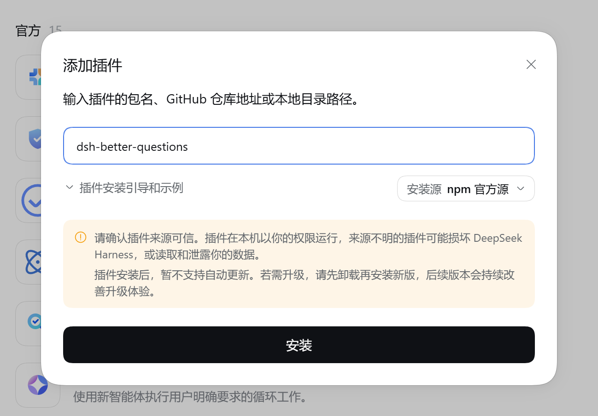

# dsh-better-questions

[](https://github.com/AExiaoliou/dsh-better-questions/actions/workflows/ci.yml)
[](LICENSE)

A prototype-aware question plugin for [DeepSeek Harness](https://github.com/deepseek-ai/deepseek-harness). It provides the `ask_with_prototype` tool with paginated questions, single and multiple choice, custom answers, recommendations, and optional prototype files that open in the Harness right sidebar. The model writes a prototype file first and passes its path; the sidebar renders the file by type, and the plugin renders nothing inline.

Recommendations only add a badge; they never select an answer. The plugin is currently version `0.2.0` and targets DSH `0.2.1-alpha.1`, Cordis `4.0.5-alpha.1`, and React 18.

- [Install and develop](#安装与开发)
- [Tool interface](#工具接口)
- [Prototype files and sidebar previews](#原型文件与侧栏预览)
- [Contributing](CONTRIBUTING.md)
- [Security policy](SECURITY.md)
- [Changelog](CHANGELOG.md)

DSH 的原型提问插件，提供 `ask_with_prototype` 工具。卡片支持分页问题、单选/多选、自定义回答和推荐标记；选项可选带一个原型文件路径，选中选项或点击“打开文件”后在 DSH 右侧栏打开该文件，由侧栏按文件类型渲染，插件不在卡片内渲染任何原型。

版本 **0.2.0**，针对 **DSH 0.2.1-alpha.1 / Cordis 4.0.5-alpha.1 / React 18** 实现。不同 DSH 版本需要重新核对契约，不能仅修改版本范围。

## 安装与开发

```sh
pnpm install --frozen-lockfile --ignore-scripts
pnpm check
pnpm pack
```

可通过 DSH CLI 安装已发布版本：

```sh
dsh plugin --profile web add dsh-better-questions
```

也可以通过 DSH 官方 `plugin_manager` 安装本地包；先执行 `list_bundles`，再执行：

```json
{"action":"install_bundle","target":"/absolute/path/to/dsh-better-questions"}
```

换到其他机器时使用实际的包目录绝对路径。安装作用于当前 profile 的所有会话。以管理器返回的 `application` 和 `warnings` 判断生效；`restart-required` 需要重启，`applied` 才表示现场应用完成。不要手改 profile 文件或在 profile 目录执行包管理命令。

安装界面示例：



源码与已编译包独立于 Harness monorepo：Host 输出 ESM，Client 输出当前版本 ModuleLoader 包装的 CJS；React 和 client-store 复用平台单例，Zod 随包构建。没有安装脚本、外部服务或远程前端资源。

常用命令：`pnpm typecheck`、`pnpm test`、`pnpm build`、`node scripts/smoke.mjs`、`pnpm measure`。`node scripts/smoke.mjs` 与 `pnpm measure` 需要先构建出 `dist/`；`pnpm check` 按顺序执行 typecheck、test、build、smoke 和 measure。

## 工具接口

```ts
interface Request {
  questions: {
    id: string;
    question: string;
    header?: string;
    multi_select?: boolean; // 默认 false
    options?: {
      label: string;
      description?: string;
      proto?: string; // 模型先写好的原型文件路径
      recommended?: boolean;
    }[]; // 默认 []
  }[];
}
interface Result {
  answers: { id: string; selected: string[]; custom?: string }[];
}
```

- 没有按题目的 `type` 字段。`proto` 不再是原型内容，而是模型在提问前写入的原型文件路径（会话工作目录相对路径或绝对路径）。选中选项或点击“打开文件”会打开该文件；交互与渲染完全由右侧栏负责。
- 批次至少一题，题目 ID 在批次内唯一；选项标签在题内唯一；每题最多一个 `recommended: true`。`options` 默认空数组，普通选择题不带 `proto` 即可。
- `proto` 可省略；提供时必须是非空字符串且表示文件路径，不能是原型内容。校验会拒绝未知字段，因此旧调用里的 `type` 会被拒绝。
- 不再有单原型 64 KiB、整批 256 KiB 的字节预算；也没有额外的题数或选项数上限。
- 结果按原始题目及选项顺序排列，`selected` 返回原始标签；允许选项和 `custom` 同时存在。空白自定义文本省略，其他自定义文本原样保留。每题都出现在结果中；跳过清空该题选择和自定义文本并返回 `selected: []`，“跳过并提交”提交整个批次。
- 关闭仅隐藏卡片，调用仍等待回答，可从工具记录重新打开；收起、关闭和跳过是不同动作。提交失败保留草稿并显示错误。已完成记录只读，仍可查看回答和打开原型文件。

工具描述原文（即工具 schema 中的实际内容）：

```text
Ask the user to choose or clarify. For a prototype option, first write the prototype file, then put its path in that option's proto; selecting the option opens the file in the right sidebar, which renders it by file type. Never put prototype content in proto. Options without proto are ordinary choices.
```

混合示例（`proto` 均为文件路径，模型须先写入这些文件）：

```json
{
  "questions": [
    {"id":"scope","question":"本次要覆盖哪些范围？","multi_select":true,"options":[{"label":"桌面端","recommended":true},{"label":"移动端"}]},
    {"id":"layout","question":"使用这个页面布局吗？","options":[{"label":"双列布局","proto":"prototypes/dashboard-layout.md","recommended":true}]},
    {"id":"style","question":"采用这个按钮样式吗？","options":[{"label":"圆角按钮","proto":"prototypes/button.html"}]},
    {"id":"contract","question":"采用这个返回结构吗？","options":[{"label":"结构化结果","proto":"prototypes/query-contract.ts"}]}
  ]
}
```

路径相对会话工作目录或为绝对路径；示例文件必须真实存在。使用前检查真实路径。

## 原型文件与侧栏预览

- 流程：模型把原型写成文件（Markdown、代码、HTML、图片、PDF、Office 文档等），在选项的 `proto` 中填入路径，用户选中该选项或点击“打开文件”后，插件以 `dsh-resource://file/session/<sessionId>/<path>` 打开该文件（绝对路径保留前导斜杠），右侧栏的 `text` 标签页（`dsh-resource://file/**` 的 fallback）承接该资源。
- 标签页内的 `documentPreviews` 注册表按文件扩展名选择渲染器：Markdown、代码、HTML、图片、PDF 和 Office 文档；未知扩展名按纯文本显示。该选择与插件无关，侧栏可以独立新增或替换渲染器。
- 插件不参与渲染：卡片内没有预览窗格、线框、代码框、HTML iframe 或 YAML 解析，也没有内容大小校验。侧栏渲染器的安全边界、扩展名能力和加载错误由侧栏自身负责。
- 选中选项会打开文件；点击选项旁的“打开文件”按钮也会打开，但不改变选择。推荐标记只显示徽标，不会自动选中答案，也不会自动打开文件。
- 插件只校验 `proto` 是非空字符串，不检查文件是否存在或可读；路径无效时由侧栏显示其自身的加载错误。

## 上下文开销

工具不再附带技能：没有 `skills/` 资源、`skills.register` 注册或题型说明注入，工具定义就是模型看到的全部插件上下文。`pnpm measure` 只统计工具定义（名称、描述、参数）的 UTF-8 字节数与 `o200k_base` 估算 token 数；它不是实际模型账单，模型 tokenizer 和框架包装会改变数值。

## 生命周期与降级

Host 使用 `tools.register`、`userQuestions.ask` 与 `sessionProjections.register`，不再使用 `skills.register`。`ask` 沿用原有 agent、signal、callId 及等待机制，没有新增回答 RPC、agent 可调用的回答工具或持久事件类型。

`betterQuestions` 投影只派生本工具日志里的活动调用元数据；任何工具结果及 turn/end 都移除对应活动项，分叉继承前缀不会复活问题。投影状态版本为 2：升级时持久化的 v1 行会被丢弃，并按当前 schema 重新回放日志；旧调用记录带 `type` 字段，严格解析失败，因此不再重放为卡片（破坏性变更）。Client 观察框架已保留的会话代际，按活动调用注册 `conversation.composer`，优先级 -1；结构化匹配 session/call/PendingQuestion，通过原有 carrier 提交或隐藏。草稿保存在 Session 范围 store 中，键仍为 `dsh.better-questions.drafts.v1`。订阅与动态注册在调用消失、会话替换、插槽撤销及插件卸载时清理。

运行中断或重启不会自动接受旧答案，也不提供超时续接。没有可关联工具日志时不能恢复卡片，基础提问通道可继续展示标准题目；没有活动回答通道时卡片不可提交。关闭后的重新打开依赖原有 `userQuestionPanels` 服务。
